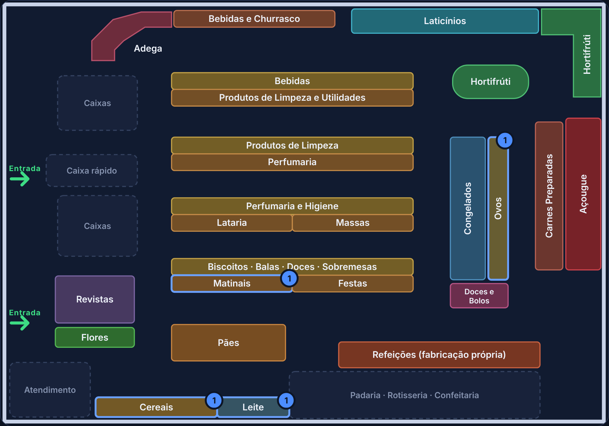
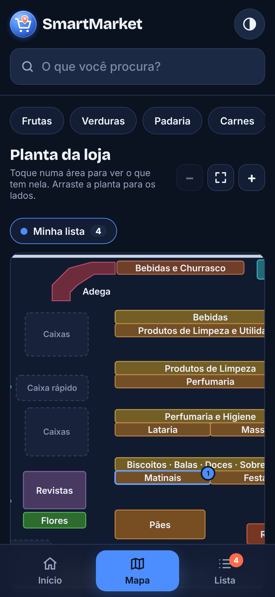
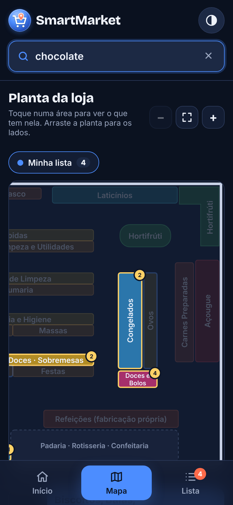
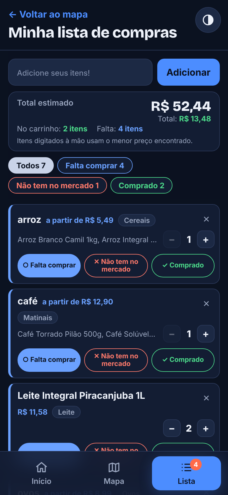
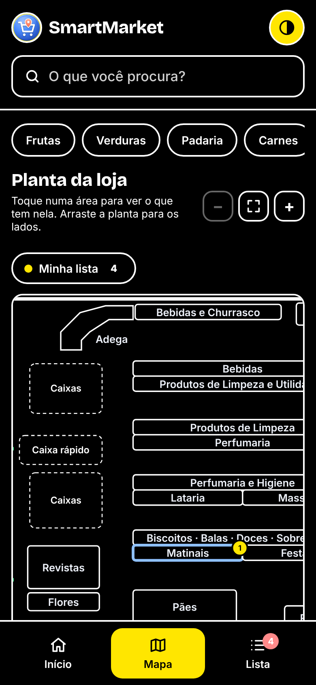

<div align="center">


# SmartMarket

**Encontre qualquer produto e veja na planta onde ele fica no mercado.**


### [🔗 Acessar o site](https://ericks1711.github.io/SmartMarket/)



</div>

---

## 📱 Telas

<table>
  <tr>
    <td align="center"><br><sub><b>Boas-vindas</b></sub></td>
    <td align="center"><br><sub><b>Planta da loja</b></sub></td>
    <td align="center"><br><sub><b>Busca na planta</b></sub></td>
    <td align="center"><br><sub><b>Lista de compras</b></sub></td>
    <td align="center"><br><sub><b>Alto contraste</b></sub></td>
  </tr>
</table>

## 💡 Sobre o projeto

Sabe quando você entra num mercado e não faz ideia de onde fica o fermento? O **SmartMarket** resolve isso: você digita o que procura e ele mostra, numa **planta interativa da loja**, em qual área o produto está. Também dá para montar a **lista de compras** e ver tudo o que precisa pegar marcado no mapa.

O site foi pensado primeiro para o **celular**, já que é usado andando pelos corredores, e foi feito só com **HTML, CSS e JavaScript puros**, sem nenhum framework.

## ✨ Funcionalidades

### 🗺️ Planta da loja
- Planta do mercado desenhada em **SVG**, com cada área clicável (Hortifrúti, Açougue, Laticínios, gôndolas...)
- Tocar numa área mostra **todos os produtos dela**, com preço e botão **+** para a lista
- **Busca** que acende só as áreas onde o produto está, com um contador em cada uma
- **Atalhos** de categorias (Frutas, Padaria, Carnes, Limpeza...)
- **Zoom** e arrastar para os lados no celular
- As áreas com itens da sua lista ficam destacadas

### 📝 Lista de compras
- Adicione vários itens de uma vez, separados por vírgula: `arroz, leite, ovos`
- Cada item mostra **em que área do mercado ele fica**, e tocar nela abre a planta já nesse lugar
- Três marcações: **Falta comprar**, **Não tem no mercado** e **Comprado**, com filtros
- **Quantidade** por item (− 1 +)
- **Total estimado da compra**, quanto já está no carrinho e quantos itens faltam
- Itens em **ordem alfabética**, com o que falta comprar sempre primeiro
- Tudo fica salvo no navegador, mesmo fechando a página

### 🔍 Busca inteligente
A mesma busca funciona no mapa e na lista e entende:
- **plural**: `feijões` acha *Feijão Carioca*
- **começo da palavra**: `choco` acha *Chocolate*
- **um erro de digitação**: `chocolat` também acha *Chocolate*
- e ignora palavras como `de`, `com` e quantidades: `2kg de arroz` acha *Arroz*

### ♿ Acessibilidade
- Botão de **alto contraste** (preto, branco e amarelo), que fica salvo entre as páginas
- Navegação por teclado na planta (Tab + Enter)
- Avisos lidos por leitores de tela (`aria-live`)
- Respeita quem prefere menos animação (`prefers-reduced-motion`)

## 🛠️ Tecnologias

| | |
|---|---|
| **HTML5** | estrutura das páginas, `<dialog>` para a confirmação de "Limpar tudo" |
| **CSS3** | variáveis de cor, Grid e Flexbox, layout pensado para o celular, tema escuro |
| **JavaScript** | sem bibliotecas: planta em SVG, busca, lista e `localStorage` |
| **Google Fonts** | Bricolage Grotesque, Inter e DM Sans |

## ▶️ Como rodar no seu computador

Não precisa instalar nada. Basta abrir o projeto com um servidor local:

```bash
git clone https://github.com/ericks1711/SmartMarket.git
cd SmartMarket
```

- **VS Code:** abra a pasta e use a extensão **Live Server** no `index.html`, ou
- **Python:** rode `python -m http.server` e acesse `http://localhost:8000`

> Na primeira visita o site abre a tela de boas-vindas; depois disso vai direto para a planta.

## 📂 Estrutura

```
SmartMarket/
├── index.html          → planta da loja + busca (página principal)
├── lista.html          → lista de compras
├── boas-vindas.html    → apresentação da primeira visita
├── css/
│   ├── style.css       → base: cores, topo, abas e cartões
│   ├── mapa.css        → planta da loja
│   ├── lista.css       → lista de compras
│   └── boas-vindas.css
├── js/
│   ├── data.js         → produtos, seções e áreas da planta
│   ├── comum.js        → funções usadas por mais de uma página (busca, lista salva…)
│   ├── mapa.js         → desenho e interação da planta
│   ├── lista.js        → lista de compras
│   ├── boas-vindas.js
│   └── contraste.js    → botão de alto contraste
├── img/
└── docs/prints/        → imagens deste README
```

## 🗃️ Como os dados funcionam

Tudo fica no `js/data.js`, sem banco de dados:

- **`produtos`**: 581 produtos, cada um com nome, preço e número da seção
  ```js
  { id: 61, nome: "Banana Prata 1kg", valor: 6.99, seção: 1 }
  ```
- **`NOMES_SECOES`**: o nome de cada uma das 48 seções (`1: "Frutas"`, `15: "Mercearia"`...)
- **`AREAS_MAPA`**: liga cada área da planta às seções que ficam nela
  ```js
  "hortifruti": { nome: "Hortifrúti", secoes: [1, 2] }
  ```
- **`REGRAS_AREA`**: exceções para produtos que ficam fora da área da sua seção. Os ovos, por exemplo, são da seção Laticínios, mas na planta ficam no balcão "Ovos"

**Para adicionar um produto**, basta incluir uma linha em `produtos`; ele aparece na busca, na planta e na lista automaticamente.
**Para mudar algo de lugar na planta**, troque a seção de área em `AREAS_MAPA` ou crie uma regra em `REGRAS_AREA`.

## 📌 Padrão de commits

| Prefixo | Uso |
|---|---|
| `feat:` | nova funcionalidade |
| `fix:` | correção de bug |
| `style:` | mudanças visuais, sem mexer na lógica |
| `refactor:` | reorganização do código sem mudar o comportamento |
| `docs:` | documentação |
| `chore:` | manutenção e configurações |

## 👤 Autor

Feito por **Erick**: [@ericks1711](https://github.com/ericks1711)
